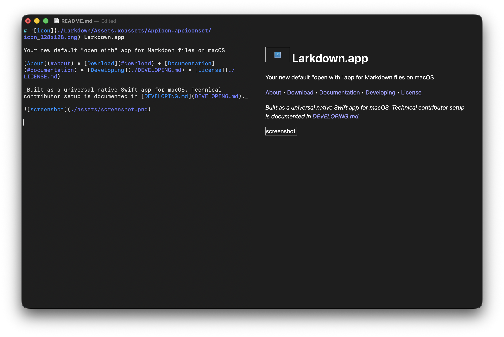

<h1>

  
   Larkdown.app
</h1>
  

	<strong>Your new default "open with" app for markdown files on macOS</strong>
     
    <a href="#about">About</a>
    ·
    <a href="#download">Download</a>
    ·
    <a href="DEVELOPING.md">Developing</a>
    ·
    <a href="LICENSE.md">License</a>
  

_Built as a universal native Swift app for macOS._

## About

Larkdown is a markdown editor that displays a rendered preview of the content in a side-by-side pane that updates as you type.

While there are other options available for viewing markdown files on macOS, they often come bundled within a larger piece of software. Larkdown is focused specifically on providing a fast, focused, stand-alone experience for quickly editing and viewing markdown files.

## Download

Larkdown can be downloaded as a `.dmg` from the [latest GitHub release](https://github.com/mikeokner/Larkdown/releases/latest).

Larkdown is free, open-source software with a publicly-verifiable build, signing, and release workflow in [GitHub Actions](https://github.com/mikeokner/Larkdown/actions/workflows/release.yml).
